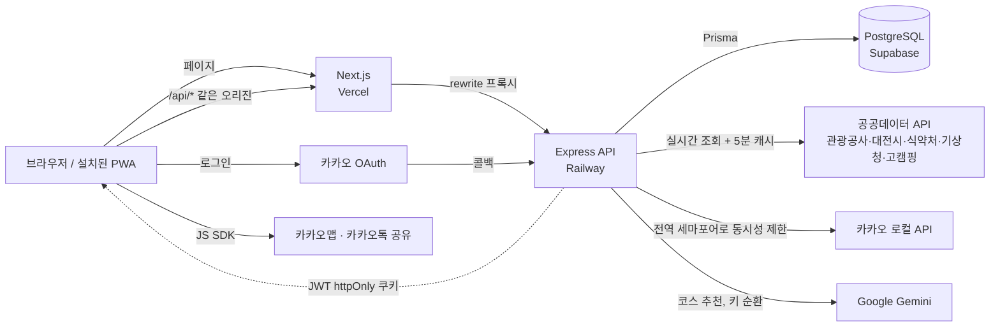

# 대저니유 (DaeJourneyU)

대전 관광지를 골라 코스와 일정으로 묶는 여행 PWA. 장소마다 반려동물 동반 가능 여부와 그 조건을 함께 보여준다.

- 배포: https://daejourneyu.vercel.app
- 팀 저장소(배포 기준 코드, `develop` 브랜치): https://github.com/seolkimleeseon/daejourneyu
- 이 저장소: 팀 저장소의 개인 포크. 팀 작업 이후의 리팩토링·테스트·CI 작업이 들어 있다([아래](#팀-작업-이후-개인-포크에서-한-작업) 참고).

<!-- 대표 화면 캡처: 홈 / 댕댕지도 / 코스 만들기 / 코스 상세(동선 지도) 4장 -->
<!--  -->

> 이름: Dae(대전) + journey + 유(충청 사투리 / "you"). 워드마크 `DaeJourneyU`, 로마자 병기 `Daejeoniyu`.

## 프로젝트 개요

| | |
|---|---|
| 공모전 | 2026 관광데이터 활용 공모전 출품작 |
| 팀 | 4인 — 기획은 4인 공동, 개발은 3인 |
| 기간 | 2026-08-12 ~ 2026-09-21 (커밋 기준). 개인 포크 작업 2026-10 |
| 서비스 방향 | 반려동물 전용 서비스가 아니라, 대전 관광 서비스에 "반려동물 동반 여부" 필터를 더한 것 |

동반 여부를 예/아니오 하나로 뭉치지 않는다. 장소마다 `petFriendly`(동반 가능 여부)와 `condition`
(예: "전 견종 · 목줄 필수"), `smallDogOnly`를 따로 두어 조건까지 보여준다.

**주요 화면**

| 탭 | 화면 |
|---|---|
| 홈 | 날씨, 혼잡도 티커, 축제 캘린더, AI 코스 추천 챗봇 |
| 댕댕지도 | 구 선택 → 장소 목록(카테고리 필터·검색) → 장소 상세(카카오맵·후기) |
| 내 여정 | 코스 만들기 3종(반려동물 MBTI 추천 / 직접 짓기 / 빵지순례), 코스 보관함, 코스 상세(동선 지도·편집·이미지 저장·카카오톡 공유), 일정 캘린더 |
| 둘러보기 | 다른 사용자가 공유한 코스 게시물(검색·정렬·무한 스크롤·담기), 아티클 |
| 마이 | 반려동물 등록, 여행 뱃지, 내가 쓴 후기 |

## 내 역할

프론트엔드 3인이 하단 탭 경계로 담당을 나눴고, 백엔드는 각자 담당 화면에 필요한 API를 맡았다.
나는 **내 여정 탭 전체**와 **공공데이터·외부 API 연동, 코스 API, AI 추천 백엔드, 배포**를 맡았다.

| 영역 | 내가 한 일 |
|---|---|
| 프론트 · 내 여정 | 코스 보관함·상세(편집 모드, 삭제, 이미지 저장·카카오톡 공유 카드), 코스 생성 위저드(반려동물 MBTI 추천·직접 짓기·빵지순례, 드래그 순서 변경), 동선 지도, 일정 캘린더(여러 날짜 등록, 1박 이상 일정 표시) |
| 프론트 · 그 외 | AI 코스 추천 챗봇 UI, MBTI 질문·결과 콘텐츠와 캐릭터 일러스트, 웹 와이드 화면용 반응형 앱 프레임 |
| 백엔드 · 데이터 | 공공데이터 API 연동(관광공사·대전시·식약처·기상청·고캠핑·문체부 동반시설), 카카오 로컬 API(지오코딩·키워드·이미지 검색), 장소 목록 실시간 집계 `/api/places` |
| 백엔드 · 기능 | 코스 CRUD·일정 API, AI 코스 추천(`/api/ai/course-suggestion`), 아티클 "도움돼요" 저장 |
| 배포·운영 | Vercel·Railway·Supabase 배포와 배포 가이드, Safari·PWA 로그인 문제 수정, 코스 저장 시 서버 다운 장애 수정 |
| 개인 포크 | TanStack Query로 서버 상태 일원화, MSW 기반 화면 테스트, ESLint·GitHub Actions CI ([아래](#팀-작업-이후-개인-포크에서-한-작업)) |

**팀 작업** (내가 하지 않은 부분)

| 담당 | 영역 |
|---|---|
| 팀원 A ([@ksykma](https://github.com/ksykma)) | 둘러보기·게시물, 아티클, 온보딩, 마이 탭·여행 뱃지, 반려동물 등록, **인증 전체(이메일 로그인·카카오 OAuth)**, Vitest 테스트 환경과 대부분의 테스트 |
| 팀원 B ([@seondy](https://github.com/seondy)) | 홈, 댕댕지도, 장소 상세·후기, 축제 캘린더, 카카오맵 공용 컴포넌트, 앱 아이콘, 초기 폴더 구조 |
| 4인 공동 | 서비스 기획 |

## 기술 스택

| 영역 | 기술 | 고른 이유 |
|---|---|---|
| 프론트 | Next.js 14.2 (App Router), React 18.3, TypeScript 5.5 | 단일 HTML 프로토타입을 재구축하며 채택. 하단 5개 탭을 `app/(shell)` 라우트 그룹과 공용 레이아웃으로 구성했다 [확인 필요: 처음 고른 이유] |
| 스타일 | Tailwind CSS 4.3 | `@theme`에 디자인 토큰을 한 번만 정의하는 CSS-first 설정. 별도 config 파일이 없다 |
| 서버 상태 | TanStack Query 5 | 서버에서 오는 데이터(장소·코스·후기·게시물)의 캐시·재조회·mutation을 한곳에서 다룬다 |
| 클라이언트 상태 | Zustand 5 | 로그인 세션, 활성 반려동물, 토스트처럼 서버와 무관한 UI 상태만 둔다 |
| PWA | next-pwa 5.6 | 홈 화면 설치용 서비스워커 생성. 개발 모드에서는 끈다 |
| 백엔드 | Express 4, TypeScript | 공공데이터 집계, 인증, 코스·게시물 API를 한 서버에서 처리한다 [확인 필요: 처음 고른 이유] |
| DB | Prisma 6 + PostgreSQL (Supabase) | 스키마·마이그레이션을 코드로 관리한다. Supabase는 내부적으로 AWS RDS 기반이라 이전할 때 `DATABASE_URL`만 바꾸면 된다(배포 문서) |
| 검증 | zod 4 | 요청 본문 검증에 쓴다 |
| AI | Google Gemini (`@google/genai`) | 무료 티어로 운영하기 위해 Anthropic API에서 전환했다 |
| 외부 API | 카카오 로그인·지도·공유·로컬, 공공데이터포털·대전시 오픈 API | |
| 테스트 | Vitest 4, Testing Library, supertest (+ 포크: MSW 2) | 프론트·백엔드가 같은 러너를 쓴다. TS·ESM 설정 없이 바로 돈다 |
| 배포 | Vercel / Railway / Supabase | Vercel은 Next.js를 설정 없이 지원하고, Railway는 서버리스 제약(콜드 스타트·타임아웃) 없이 Express를 컨테이너로 그대로 띄운다(배포 문서) |

## 아키텍처



- 프론트의 `/api/*`는 `next.config.mjs` rewrite로 백엔드에 프록시된다. 브라우저 입장에서는 같은 오리진이라
  인증 쿠키가 퍼스트파티 쿠키로 붙는다(이렇게 정한 이유는 [기술적 판단 3](#3-배포-환경에서만-생긴-로그인-문제)).
- 로그인은 이메일·비밀번호(bcrypt)와 카카오 OAuth 두 가지이고, 둘 다 백엔드가 JWT를 httpOnly 쿠키로 발급한다.
  프론트는 앱 시작 시 `/api/auth/me`로 세션을 복구한다.

```
daejourneyu/
├─ frontend/   Next.js — app/(shell)/{home,map,schedule,feed,my}, src/{components,hooks,stores,lib,mocks,types}
├─ backend/    Express — src/routes(도메인별 라우터), src/lib(외부 API 클라이언트·집계), prisma/
└─ docs/       배포 가이드 등
```

## 기술적 판단

각 항목은 문제 → 판단 → 결과 순서다. 1~4는 배포된 서비스(팀 저장소 `develop`)에 들어간 작업이고,
5~6은 팀 작업 이후 개인 포크에서 한 작업이다.

### 1. 장소 데이터: DB 적재 대신 실시간 집계 + 짧은 캐시

**문제.** 장소 목록은 관광공사·대전시·식약처·고캠핑·문체부 동반시설 등 여러 공공데이터를 합쳐서 만든다.
처음에는 스크립트로 한 번 받아 DB에 적재했는데, 공모전 규칙상 공공데이터를 실시간으로 연동해야 했다.
그렇다고 요청마다 모든 소스를 호출하면 소스별 일일 호출 한도를 금방 쓰고 응답도 느려진다.

**판단.** 요청 시점에 소스들을 조회해 합치는 집계 모듈(`placesAggregator`)로 바꾸고, 결과 전체를 5분 TTL로
메모리에 캐시했다. DB 스냅샷이 아니라 API 응답을 잠깐 담아 두는 것이라 실시간 연동이라는 조건은 지키면서,
같은 5분 안의 요청은 호출을 공유한다. 구·카테고리·출처 필터는 캐시된 목록에서 거른다.

**결과.** DB 적재 스크립트를 없앴다. 여러 소스에 걸친 중복 제거와 출처 신뢰도 순 정렬은 집계 모듈 한곳에서 한다.

### 2. 외부 API 한도 다루기: 카카오 동시성 제한, AI 키 순환과 응답 검증

**문제.**
- 장소 사진·좌표를 채우려고 카카오 이미지·지오코딩 API를 장소마다 호출하는데, 소스마다 수십~백여 건을
  `Promise.all`로 한꺼번에 보내면 429(레이트리밋)로 대부분 실패했다.
- 호출부마다 동시성을 제한해도, "전체" 카테고리처럼 여러 소스가 동시에 돌면 프로세스 전체 요청 수는 소스 수만큼 불어났다.
- AI 추천은 Gemini 무료 티어라 429·503이 잦았고, Gemini는 응답 형식 강제가 약해서 후보 목록에 없는 장소 id를
  지어내거나 요청한 개수를 지키지 않을 때가 있었다.

**판단.**
- 카카오 호출은 전부 프로세스 전역 세마포어(`Semaphore`)를 거치게 했다. 호출 하나 안에서의 제한
  (`mapWithConcurrency`)과 프로세스 전체에서의 제한을 구분했다.
- Gemini는 키를 여러 개 받아 (키, 모델) 조합별로 429·503이 나면 쿨다운하고 다음 조합으로 넘어간다.
  전부 실패하면 429를 우선 알려, 마지막 503에 원인이 가려지지 않게 했다.
- AI 응답은 그대로 쓰지 않고 검증 함수(`sanitizeSuggestion`)로 후보에 없는 id를 걸러낸다.

**결과.** 동시 요청 수가 프로세스 단위로 상한을 가진다. AI 응답이 형식을 어겨도 화면에 없는 장소가 나오지 않는다.

### 3. 배포 환경에서만 생긴 로그인 문제

인증 기능 자체는 팀원이 구현했다. 아래는 배포 후 생긴 문제를 내가 추적하고 고친 과정이다.

**문제 1 — 프록시 지연.** 프론트 → Vercel rewrite → Railway 경로에서 API 요청마다 0.5초 안팎의 고정 지연이 붙었다.

**판단 1.** 브라우저가 Railway를 직접 호출하도록 바꾸고(`apiUrl` 헬퍼로 일괄 처리), 크로스 오리진에서도
쿠키가 붙도록 `SameSite=None; Secure`로 바꿨다. CORS를 프론트 단일 출처 + credentials로 제한하고,
상태를 바꾸는 요청은 모두 JSON이라 preflight를 거치므로 CSRF 노출 범위는 늘지 않는다고 판단했다.

**문제 2 — Safari에서 로그인이 풀림.** 이후 Safari(모바일·데스크톱)에서 로그인은 끝나는데 다음 화면에서
로그인이 안 된 것처럼 보였다. 크로스 오리진 호출 때문에 인증 쿠키가 서드파티 쿠키가 됐고,
Safari의 ITP는 `SameSite` 값과 무관하게 서드파티 쿠키를 막는다.

**판단 2.** 쿠키를 `SameSite=Lax`로 되돌리고 다시 같은 오리진 프록시를 쓰게 했다. 백엔드 리전을 옮긴 뒤
다시 재 보니 프록시를 우회해서 얻는 이득이 크지 않아, 되돌려도 잃는 게 적었다.

**문제 3 — 설치된 PWA.** 홈 화면에 설치한 PWA에서 카카오 로그인으로 나가면 OS가 그 이동을 시스템 브라우저로
넘기는 경우가 있다. 로그인은 성공하지만, 원래 PWA 창은 처음 마운트할 때 확인한 비로그인 상태에 머물렀다.

**판단 3.** 앱이 다시 화면에 보일 때(`visibilitychange`)도 `/api/auth/me`로 세션을 다시 확인한다.

**결과.** 속도 개선 하나가 특정 브라우저의 쿠키 정책과 충돌하는 걸 겪고, 측정 결과를 다시 보고 되돌렸다.
인증 쿠키를 퍼스트파티로 유지한다는 원칙과 그 이유를 쿠키 발급 코드(`setAuthCookie`) 주석에 남겼다.

### 4. 코스 저장 한 번에 서버 전체가 죽던 장애

**문제.** 코스를 저장하면 서버 전체가 502를 냈다. 프론트 타입에만 있는 필드(`placeUrl`)가 그대로 Prisma
`create`에 넘어가 예외가 났고, 그 라우터가 비동기 에러 처리 래퍼(`asyncHandler`)로 감싸져 있지 않아
처리되지 않은 Promise 거부가 Node 프로세스를 종료시켰다. 백엔드 테스트는 Prisma를 mock하기 때문에
"모르는 필드" 예외를 잡지 못했다.

**판단.** DB 컬럼만 남기는 변환 함수(`toStopData`)를 두고, 코스 라우터 전체를 `asyncHandler`로 감쌌다.
같은 종류의 예외가 다시 생겨도 500 응답으로 끝나게 하는 것을 우선했다.

**결과.** 재발 방지 테스트 2개(모르는 필드 제거, 예외가 프로세스를 죽이지 않고 500으로 응답)를 추가했다.
mock 기반 테스트가 무엇을 보장하지 못하는지 확인한 계기가 됐다.

### 5. 서버 상태와 클라이언트 상태 분리 (개인 포크)

**문제.** 코스·일정은 TanStack Query로 받은 데이터를 `useEffect`로 Zustand 스토어에 복사하고, 화면은 스토어를
읽었다. 정본이 둘이라 다음이 필요했다.
- "서버 목록을 받았는지" 표시하는 `hasSynced` 플래그와 목데이터 초기값
- 오래된 캐시 응답이 방금 저장한 코스를 덮어쓰지 않게 하는 병합 로직
- 실제로 이 구조에서 "목데이터가 안 지워짐", "저장 후 늦게 뜸", "캘린더 무한 렌더링" 버그를 각각 고쳤다

또 코스 수정·삭제는 화면부터 바꾸면서도 실패 시 되돌리지 않아, 화면과 서버가 어긋난 채로 남을 수 있었다.

**판단.**
- 서버가 정본인 데이터는 Query 캐시에만 둔다. Zustand에는 세션·활성 반려동물·토스트만 남긴다.
  "로딩 중"은 `data === undefined`로 판단한다.
- queryKey를 팩토리(`lib/queryKeys.ts`)로 모으고, 첫 칸을 도메인 = 무효화 단위로 정했다.
  `["reviews"]`를 무효화하면 전체 목록과 장소별 목록이 함께 무효화된다.
- 수정은 낙관적으로 반영한다. `onMutate`에서 진행 중인 조회를 취소하고(`cancelQueries`, 늦게 도착한 응답이
  낙관적 값을 덮지 않게) 캐시를 고친다. 실패하면 **스냅샷 전체가 아니라 바꾼 항목만** 원래 자리에 되돌린다.
  두 변경이 겹쳤을 때 먼저 실패한 쪽이 다른 변경까지 되돌리지 않게 하기 위해서다.
- mutation에 `mutationKey`를 달고, 같은 도메인의 mutation이 모두 끝났을 때만(`isMutating() === 1`) 재조회한다.
  동시 저장 중 먼저 끝난 쪽의 재조회가 나머지 낙관적 항목을 덮지 않게 한다.
- 실패 알림은 화면이 남아 있는지에 따라 위치를 나눴다. 코스 저장은 저장 직후 화면을 떠나므로 훅이 토스트를 띄우고,
  일정·후기는 호출부가 결과를 기다리므로 훅은 롤백만 하고 에러를 넘긴다.

**결과.** `useCourseStore`, `useSyncCoursesFromApi`, `hasSynced`, 병합 로직을 지웠다. 롤백·동시 저장 가드는
코드를 일부러 지웠을 때 실패하는 테스트로 고정했다. 이 작업은 배포본에는 반영돼 있지 않다.

### 6. 사용자 관점 화면 테스트와 MSW (개인 포크)

**문제.** 기존 테스트는 페이지 테스트가 데이터 훅을 통째로 mock하고, 훅 테스트는 API 클라이언트를 mock했다.
그래서 "화면 → Query 훅 → fetch"가 실제로 맞물리는지 확인하는 테스트가 없었다. 쿼리키·무효화·롤백이 어긋나도
모든 테스트가 통과할 수 있었다. 또 화면 대부분에 조회 실패 화면이 없어서, 실패가 "후기 없음", "코스를 찾을 수
없어요"로 보였다.

**판단.**
- fetch를 직접 mock하지 않고 **MSW**로 네트워크 경계에서 가로챘다. 앱 코드는 하나도 바꾸지 않고, 테스트마다
  `server.use()`로 성공·실패·지연 응답을 바꿔 끼운다. 핸들러가 없는 요청은 실패시켜(`onUnhandledRequest: "error"`)
  테스트가 모르는 응답에 기대지 않게 했다.
- 요소는 `getByRole`·`getByText`로 찾고 클릭·입력으로만 조작한다. state·내부 함수는 보지 않는다.
  이 과정에서 모달·토스트에 역할(`dialog`, `status`)이 없고 삭제 버튼 이름이 모두 같다는 접근성 문제를 찾아 고쳤다.
- 테스트마다 새 QueryClient를 쓰고(캐시 공유 방지), URL에 상태를 담는 화면(지도 필터)을 위해 주소가 실제로 바뀌는
  메모리 라우터를 만들었다.
- 대상: 내가 쓴 후기(목록·페이지·낙관적 삭제·롤백), 일정 추가(달력 선택·낙관적 등록·취소·롤백), 댕댕지도(필터·검색·더 보기).
  조회 실패 시 에러 안내와 "다시 시도" 버튼을 먼저 추가하고 테스트했다.
- 일부러 테스트하지 않은 것: 서버 컴포넌트(레이아웃·redirect뿐이고 Testing Library로 async 서버 컴포넌트를
  렌더할 수 없다), 카카오맵·공유 SDK(jsdom에서 의미 있게 실행할 수 없다), 로그인 흐름(화면 테스트에서는 로그인
  상태를 스토어에 직접 넣는다).

**결과.** 처음 쓴 롤백 테스트는 롤백 코드를 지워도 통과했다. 실패 직후의 재조회가 항목을 다시 채워 넣었기 때문이다.
재조회 응답을 붙잡아 둔 상태에서 확인하도록 고쳐, 롤백만으로 화면이 돌아오는지를 검증한다.
대상 코드를 일부러 망가뜨려 각 테스트가 실패하는 것을 확인했다.

## 팀 작업 이후: 개인 포크에서 한 작업

팀 저장소 `main`(2026-09-14 시점)을 포크해서 2026-10에 진행했다. **배포본(팀 저장소 `develop`)에는 반영되지 않았다.**

| 작업 | 내용 |
|---|---|
| TanStack Query 일원화 | 위 [기술적 판단 5](#5-서버-상태와-클라이언트-상태-분리-개인-포크) |
| 화면 테스트 | 위 [기술적 판단 6](#6-사용자-관점-화면-테스트와-msw-개인-포크). MSW v2, `renderWithProviders`, 메모리 라우터 |
| 에러 화면·접근성 | 조회 실패 안내와 다시 시도, Modal `role="dialog"`, Toast `role="status"` |
| 린트·CI | ESLint(`next/core-web-vitals`) 설정, GitHub Actions로 PR마다 프론트·백엔드 타입 검사·린트·테스트 |
| 기타 | 카카오 API 세마포어의 대기열을 배열(`shift` O(n))에서 연결 리스트 큐(O(1))로 교체 |

## AI 활용 방식

팀 전체가 Claude Code로 개발했다.

- **규칙을 저장소에 둠.** 루트·`frontend`·`backend`의 `CLAUDE.md`에 아키텍처, 도메인 용어, 컨벤션, 3인 담당 범위를
  적어 두고 세션마다 같은 규칙을 따르게 했다. 담당 밖 파일과 공용 리소스는 고치지 않는다는 규칙도 여기 있다.
- **분석 → 확인 → 구현 순서.** 큰 작업은 먼저 수정 없이 분석만 받고, 범위와 방향을 정한 뒤 진행했다.
  커밋은 화면·단계 단위로 나눴다.
- **AI가 만든 코드의 검증.**
  - 단계마다 `tsc --noEmit`, `next lint`, `vitest`, `next build`를 통과시켰고, 같은 명령을 CI에서 다시 돌린다.
  - 테스트가 실제로 무언가를 잡는지 확인하려고 대상 코드를 일부러 지워 보고 실패하는지 봤다.
    롤백 테스트가 롤백 없이도 통과하던 구멍은 이 방법으로 찾았다([기술적 판단 6](#6-사용자-관점-화면-테스트와-msw-개인-포크)).
  - 커밋은 직접 했다. AI가 바꾼 동작 중 화면에 영향이 있는 것(예: 조회 재시도 횟수, 실패 토스트 추가)은
    커밋 메시지와 PR 본문의 "동작 변화" 항목에 따로 적었다.

## 실행 방법

배포 기준 코드는 팀 저장소 `develop` 브랜치다. 이 포크의 `main`도 같은 방법으로 실행된다.

필요: Node.js 22 이상(로컬 DB를 `prisma dev`로 띄우려면 24 LTS 권장), npm.

```bash
# 1) DB — Prisma가 관리하는 로컬 Postgres (백그라운드 실행)
cd backend
npx prisma dev --name daejourneyu --detach
npm install
npx prisma migrate dev

# 2) 백엔드 — http://localhost:4000
npm run dev

# 3) 프론트 — http://localhost:3000 (다른 터미널)
cd frontend
npm install
npm run dev
```

DB는 `npm run dev`에 딸려 오지 않는다. 로그인·가입 API가 갑자기 500을 내면 `npx prisma dev ls`로 DB가 떠 있는지
먼저 확인한다.

**환경변수** — 템플릿을 복사해서 채운다. 실제 키는 저장소에 넣지 않는다.

`backend/.env` (`backend/.env.example` 복사)

| 이름 | 용도 |
|---|---|
| `DATABASE_URL` | Postgres 접속 URL. 로컬은 `prisma dev`가 알려주는 URL |
| `DIRECT_URL` | 마이그레이션용 직접 접속 URL. 스키마가 요구하므로 로컬도 넣는다(로컬은 `DATABASE_URL`과 같은 값). `.env.example`에는 빠져 있다 |
| `JWT_SECRET` | 인증 토큰 서명 키 |
| `FRONTEND_ORIGIN` | CORS 허용 출처 (로컬: `http://localhost:3000`) |
| `PUBLIC_DATA_API_KEY` | 공공데이터포털 서비스 키 |
| `KAKAO_REST_API_KEY` | 카카오 로컬 API·로그인 |
| `KAKAO_CLIENT_SECRET` | 카카오 로그인 |
| `KAKAO_REDIRECT_URI` | 카카오 로그인 콜백 (`<백엔드>/api/auth/kakao/callback`) |
| `GEMINI_API_KEYS` | Gemini 키 목록(콤마 구분). 하나면 `GEMINI_API_KEY` |

`frontend/.env.local` (`frontend/.env.local.example` 복사)

| 이름 | 용도 |
|---|---|
| `NEXT_PUBLIC_KAKAO_JS_KEY` | 카카오 JS SDK(지도·카카오톡 공유) |
| `BACKEND_ORIGIN` | `/api/*` rewrite 대상. 로컬은 비워 두면 `http://localhost:4000` |

배포 절차와 겪었던 문제는 [`docs/deployment.md`](docs/deployment.md)에 있다.

## 테스트 · CI

```bash
cd frontend
npm test             # Vitest 1회 실행
npm run test:watch
npm run typecheck    # tsc --noEmit  (포크)
npm run lint         # next lint      (포크)

cd backend
npm test
npm run typecheck    # (포크)
```

- 프론트는 확장자로 환경이 갈린다. `*.test.ts`는 node(순수 함수·스토어), `*.test.tsx`는 jsdom + Testing Library.
- 백엔드 라우트 테스트는 supertest로 실제 라우터를 태우고 Prisma·인증만 mock한다.
- 화면 테스트(포크)는 MSW 가짜 서버(`frontend/src/test/msw`)와 `renderWithProviders`(테스트마다 새 QueryClient)를 쓴다.
- CI(포크): `.github/workflows/ci.yml`이 PR과 `main` push마다 프론트(타입 검사·린트·테스트)와 백엔드(타입 검사·테스트)를 병렬로 돌린다.
